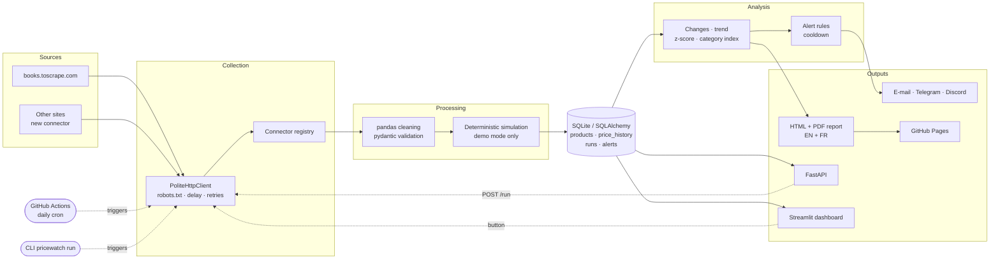
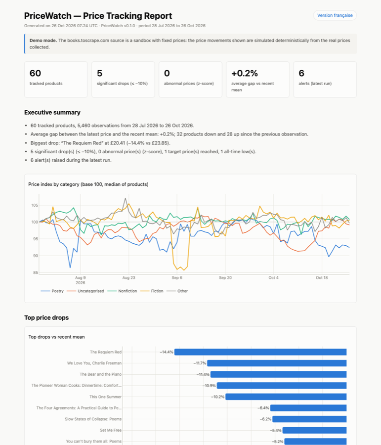

# PriceWatch

[](https://github.com/fleury-fcn/pricewatch-automation/actions/workflows/ci.yml)
[](https://github.com/fleury-fcn/pricewatch-automation/actions/workflows/ci.yml)
[](https://github.com/fleury-fcn/pricewatch-automation/actions/workflows/daily-pipeline.yml)
[](https://pricewatch-automation.streamlit.app)
[](pyproject.toml)
[](LICENSE)

[🇫🇷 Français](README.md) · 🇬🇧 English

> **PriceWatch** is an automated e-commerce price-tracking pipeline. With one command or
> one click it **collects**, **cleans**, **stores** and **analyses** prices, sends
> **alerts**, and produces a dated **PDF/HTML report** with an executive summary.

| | |
|---|---|
| 🖥️ **Live demo** | <https://pricewatch-automation.streamlit.app> |
| 📄 **Latest report** (rebuilt daily by GitHub Actions) | 🇬🇧 [HTML](https://fleury-fcn.github.io/pricewatch-automation/en/) · [PDF](https://fleury-fcn.github.io/pricewatch-automation/latest_en.pdf) — 🇫🇷 [HTML](https://fleury-fcn.github.io/pricewatch-automation/) · [PDF](https://fleury-fcn.github.io/pricewatch-automation/latest_fr.pdf) — [archive](https://fleury-fcn.github.io/pricewatch-automation/archive/) |
| 📑 **Versioned sample report** | 🇬🇧 [HTML](reports/examples/pricewatch_report_example_en.html) · [PDF](reports/examples/pricewatch_report_example_en.pdf) — 🇫🇷 [HTML](reports/examples/pricewatch_report_example_fr.html) · [PDF](reports/examples/pricewatch_report_example_fr.pdf) |


> Reports are produced **in English and in French**. The dashboard interface is in French.

## The problem

Tracking prices by hand (competitors, purchasing, pricing intelligence) is repetitive,
error-prone and leaves no usable history. The goal is a tool that:

1. collects prices **regularly and politely** (without hammering websites);
2. produces **clean, validated** and historised data;
3. **automatically flags** what matters: significant drops, abnormal prices, target
   prices reached;
4. **notifies** (e-mail, Telegram, Discord) and **reports** in a form a non-technical
   reader can use;
5. runs **unattended**, every day.

## What PriceWatch does

| Stage | Implementation |
|---|---|
| **Collection** | `httpx` + `BeautifulSoup`; honours `robots.txt` and `Crawl-delay`, per-host throttling, explicit User-Agent, retries with exponential backoff and `Retry-After`. **Connector** architecture (registry + decorator): a new website is one class. |
| **Cleaning** | `pandas`: FR/EN price formats (`1 234,56 €`, `$1,234.56`), ISO currencies, mojibake (`£`), stock availability, duplicates, missing values. Row-level validation with a **pydantic** schema, with a reason for every rejection. |
| **Storage** | **SQLite** through **SQLAlchemy 2**: products, price history, runs, alerts. `(product_id, collected_at)` index, idempotent inserts (`ON CONFLICT DO NOTHING`), timestamps guaranteed UTC. PostgreSQL-compatible. |
| **Analysis** | Change vs previous observation and vs window mean, **trend** (linear regression, %/day), **z-score** of the latest price against prior history, all-time lows, per-category price index. |
| **Alerts** | Significant drop, target price reached, anomaly; anti-spam cooldown (72 h); **console, e-mail (smtplib), Telegram, Discord** channels; messages in French or English (`alerts.language`). |
| **Report** | **Interactive HTML** (Plotly + Jinja2) and **PDF** (matplotlib + ReportLab), dated, **in English and French** (text, charts, number and date formats, alert messages), with an **auto-written executive summary**, top drops, alerts and methodology. |
| **Interfaces** | **Typer CLI**, **FastAPI** REST API (Swagger at `/docs`), **Streamlit dashboard** with a "Run pipeline" button and PDF download. |
| **Automation** | **GitHub Actions**: daily cron run + report published to **GitHub Pages**; CI with lint, type checking, tests and Docker image smoke test. |

## Architecture



Every entry point (CLI, API, dashboard, cron) calls the same
[`run_pipeline`](src/pricewatch/pipeline.py) function, which records each run in the
database (`success` / `partial` / `failed`, counters, errors).

## Installation

Requirements: **Python 3.12+**, Git.

```bash
git clone https://github.com/fleury-fcn/pricewatch-automation.git
cd pricewatch-automation
python3.12 -m venv .venv && source .venv/bin/activate   # Windows: .venv\Scripts\activate
pip install -r requirements-dev.txt && pip install -e . --no-deps
cp .env.example .env            # optional: alert channel secrets
pre-commit install              # optional: ruff + black hooks
```

## Usage

```bash
pricewatch init-db                 # create tables
pricewatch seed-demo --days 90     # (optional) 90 days of demo history
pricewatch run                     # collect → clean → store → analyse → alert → report
pricewatch report                  # rebuild the EN + FR reports from the database
pricewatch report --lang en        # English only (or --lang fr)
pricewatch status                  # data volume and latest runs
pricewatch api                     # API at http://127.0.0.1:8000/docs
pricewatch dashboard               # dashboard at http://localhost:8501
```

Everything is configured in [`config/config.yaml`](config/config.yaml) (sources, pages,
watchlist and target prices, analysis thresholds, alert channels, cron). The file is
validated on load, so a misspelled key is rejected. Secrets live in `.env` or GitHub secrets,
never in YAML.

**REST API**: `GET /health`, `/products`, `/prices`, `/stats`, `/alerts`, `/runs`,
`/reports/latest.{html,pdf}?lang=en|fr` and `POST /run`, which runs the pipeline in the background with a
concurrency lock and an optional `X-API-Key`. Interactive docs are served at `/docs`.

**Docker**: `docker compose up -d api dashboard`, then `docker compose run --rm pipeline`.

## Live demo

The dashboard hosted on **Streamlit Community Cloud** does not need persistent storage:
on start-up it builds a temporary SQLite database from the versioned dataset in
[`data/demo/`](data/demo) (60 real books, 90 days of history). The **Run pipeline**
button performs a real collection, or replays it offline. Step-by-step deployment is in
[docs/DEPLOYMENT.md](docs/DEPLOYMENT.md).

| PDF report | HTML report (GitHub Pages) | API (Swagger) |
|---|---|---|
|  |  |  |

## Results

- **60 real products** collected in ~70 s at 1 request/second with **0 rejections**;
  5,400+ observations after the demo seed;
- full pipeline (collection to PDF report) in **~2 minutes** on GitHub Actions, every day
  at 06:00 UTC, with the report published automatically;
- over 30 days, a median of **5 significant drops** (0 to 9) and **3 anomalies** (0 to 5)
  per day across 60 products. A per-run cap and a cooldown keep alerts actionable;
- **151 tests** (unit and integration, HTTP mocked with `respx`, dashboard tested with
  `AppTest`), **~98 % coverage**, zero `mypy` errors, and the Docker image is tested in CI.

## Limitations

- **Demo data**: books.toscrape.com is a sandbox with fixed prices, so price movements are
  **simulated** (`simulate_price_moves` option, deterministic, stated in every report).
  Collection itself is real.
- No JavaScript rendering: sites that inject prices client-side need a dedicated
  connector (Playwright).
- **Static** exchange rates (configurable). SQLite suits a single writer.
- The z-score assumes a roughly stable distribution, so strongly seasonal products may
  trigger false positives.
- GitHub cron runs can be delayed by a few minutes. The Streamlit demo sleeps after
  inactivity and loses its runs on restart, by design.

## Roadmap

- More connectors (Playwright for dynamic sites, marketplace APIs);
- PostgreSQL with Alembic migrations, Prefect/Airflow orchestration;
- daily exchange rates (ECB API);
- robust anomaly detection (MAD, seasonal decomposition, Isolation Forest) and price
  forecasting;
- per-user watchlists and alert preferences, dashboard authentication.

## Quality

`ruff` (lint, docstrings enforced) · `black` · `mypy` (pydantic plugin) · `pre-commit` ·
`pytest` + `pytest-cov` (80 % gate in CI) · Conventional Commits.

## Author

**Fleury Niyokwizera** · [GitHub @fleury-fcn](https://github.com/fleury-fcn)

[MIT](LICENSE) licence.
