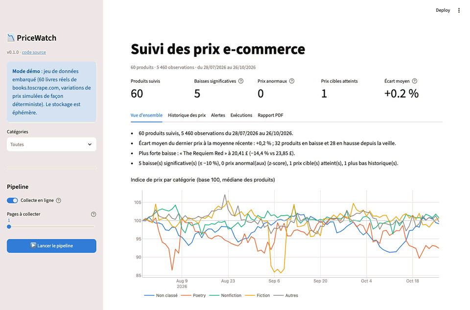
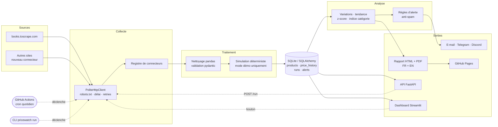
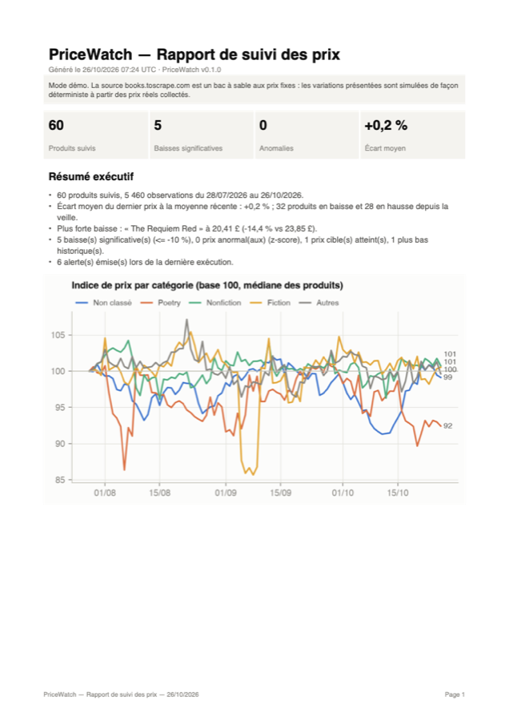
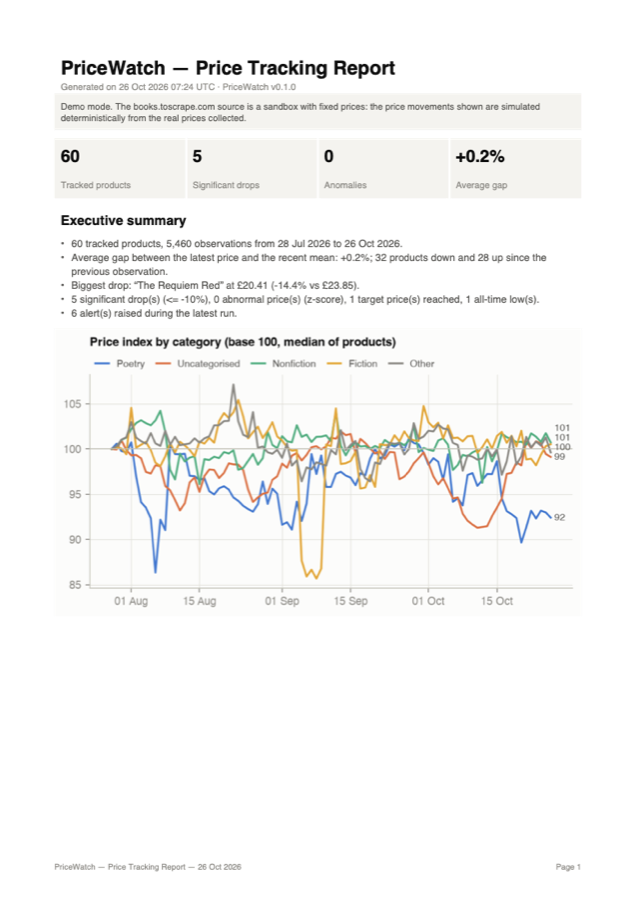
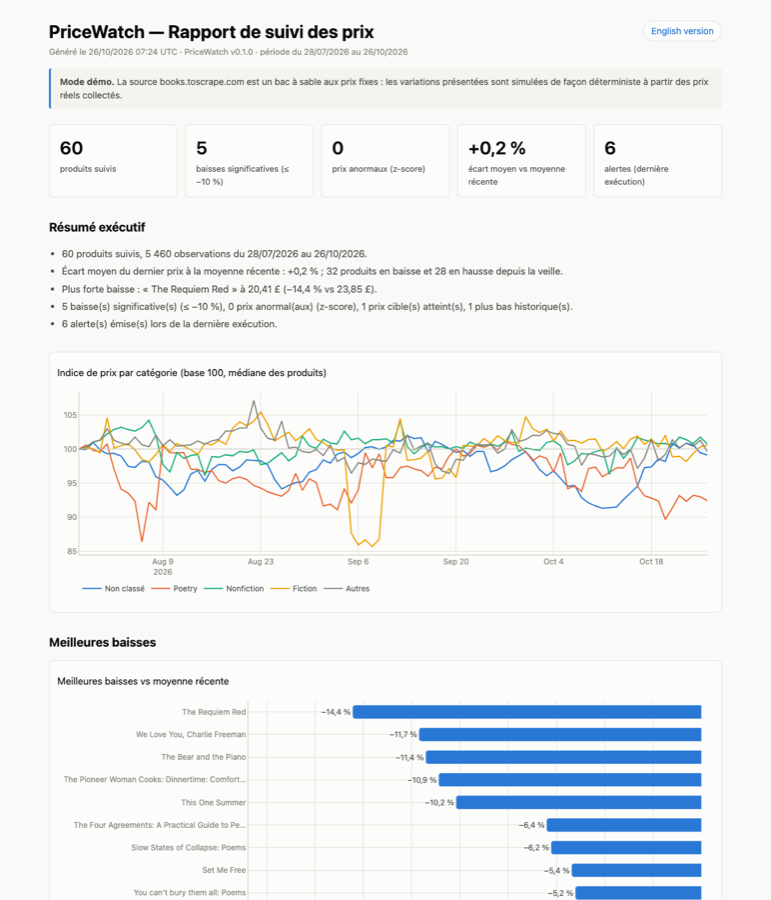
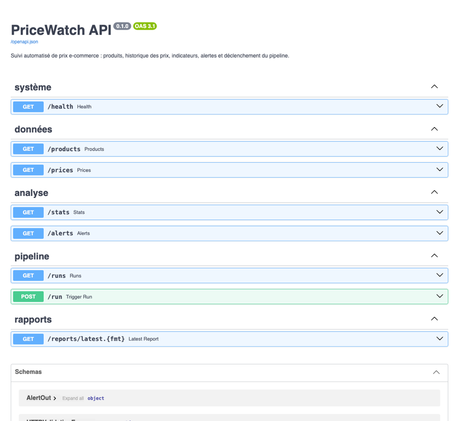

# PriceWatch

[](https://github.com/fleury-fcn/pricewatch-automation/actions/workflows/ci.yml)
[](https://github.com/fleury-fcn/pricewatch-automation/actions/workflows/ci.yml)
[](https://github.com/fleury-fcn/pricewatch-automation/actions/workflows/daily-pipeline.yml)
[](https://pricewatch-automation.streamlit.app)
[](pyproject.toml)
[](LICENSE)

🇫🇷 Français · [🇬🇧 English](README.en.md)

> **PriceWatch** est un pipeline automatisé de suivi de prix e-commerce qui, d'une seule
> commande ou d'un clic, **collecte**, **nettoie**, **stocke**, **analyse** les prix,
> envoie des **alertes** et génère un **rapport PDF/HTML** daté avec résumé exécutif.

| | |
|---|---|
| 🖥️ **Démo en ligne** | <https://pricewatch-automation.streamlit.app> |
| 📄 **Dernier rapport** (régénéré chaque jour par GitHub Actions) | 🇫🇷 [HTML](https://fleury-fcn.github.io/pricewatch-automation/) · [PDF](https://fleury-fcn.github.io/pricewatch-automation/latest_fr.pdf) — 🇬🇧 [HTML](https://fleury-fcn.github.io/pricewatch-automation/en/) · [PDF](https://fleury-fcn.github.io/pricewatch-automation/latest_en.pdf) — [archives](https://fleury-fcn.github.io/pricewatch-automation/archive/) |
| 📑 **Rapport d'exemple versionné** | 🇫🇷 [HTML](reports/examples/pricewatch_report_example_fr.html) · [PDF](reports/examples/pricewatch_report_example_fr.pdf) — 🇬🇧 [HTML](reports/examples/pricewatch_report_example_en.html) · [PDF](reports/examples/pricewatch_report_example_en.pdf) |



## Le problème

Surveiller des prix à la main (concurrence, achats, veille tarifaire) est répétitif, peu
fiable et ne laisse aucune trace exploitable. Il faut un outil qui :

1. collecte les prix **régulièrement et poliment** (sans surcharger les sites) ;
2. produit des données **propres et validées**, historisées ;
3. **détecte automatiquement** ce qui mérite l'attention : baisses significatives, prix
   anormaux, prix cibles atteints ;
4. **prévient** (e-mail, Telegram, Discord) et **rend compte** (rapport lisible par un
   non-technicien) ;
5. tourne **sans intervention**, tous les jours.

## Ce que fait PriceWatch

| Étape | Implémentation |
|---|---|
| **Collecte** | `httpx` + `BeautifulSoup`, respect de `robots.txt` et du `Crawl-delay`, délai par hôte, User-Agent explicite, retries avec backoff exponentiel et `Retry-After`. Architecture à **connecteurs** (registre + décorateur) : ajouter un site = une classe. |
| **Nettoyage** | `pandas` : prix FR/EN (`1 234,56 €`, `$1,234.56`), devises ISO, mojibake (`£`), disponibilité/stock, doublons, valeurs manquantes. Validation ligne à ligne par un schéma **pydantic**, rejets motivés. |
| **Stockage** | **SQLite** via **SQLAlchemy 2** : produits, historique de prix, exécutions, alertes. Index `(product_id, collected_at)`, insertion idempotente (`ON CONFLICT DO NOTHING`), dates UTC garanties. Compatible PostgreSQL. |
| **Analyse** | Variation vs veille et vs moyenne de fenêtre, **tendance** (régression linéaire, %/jour), **z-score** du dernier prix contre l'historique antérieur, plus bas historique, indice de prix par catégorie. |
| **Alertes** | Baisse significative, prix cible atteint, anomalie ; anti-spam (délai de 72 h) ; canaux **console, e-mail (smtplib), Telegram, Discord** ; messages en français ou en anglais (`alerts.language`). |
| **Rapport** | **HTML interactif** (Plotly + Jinja2) et **PDF** (matplotlib + ReportLab), datés, **en français et en anglais** (textes, graphiques, formats de nombres et de dates, messages d'alerte), avec **résumé exécutif rédigé automatiquement**, classement des meilleures baisses, alertes, méthodologie. |
| **Interfaces** | **CLI Typer**, **API FastAPI** (Swagger sur `/docs`), **dashboard Streamlit** avec bouton « Lancer le pipeline » et téléchargement du PDF. |
| **Automatisation** | **GitHub Actions** : exécution quotidienne (cron) + publication du rapport sur **GitHub Pages** ; CI lint + typage + tests + image Docker. |

## Architecture



Toutes les entrées (CLI, API, dashboard, cron) appellent la même fonction
[`run_pipeline`](src/pricewatch/pipeline.py), qui trace chaque exécution en base
(`success` / `partial` / `failed`, compteurs, erreurs).

```text
src/pricewatch/
├── collectors/        # client HTTP poli, registre, connecteur books.toscrape
├── cleaning.py        # normalisation pandas + validation pydantic
├── storage/           # modèles SQLAlchemy et dépôt (requêtes d'historique)
├── analysis.py        # variations, tendances, z-score, indices
├── alerts.py          # règles + notifieurs (smtplib, Telegram, Discord)
├── reporting/         # graphiques Plotly/matplotlib, rapport Jinja2/ReportLab, site Pages
├── pipeline.py        # orchestration de bout en bout
├── simulation.py      # variations de prix déterministes (démo)
├── demo.py            # jeu de données embarqué
├── cli.py · api.py    # interfaces Typer et FastAPI
app/streamlit_app.py   # dashboard
config/config.yaml     # sources, watchlist, seuils, planification
```

## Installation

Prérequis : **Python 3.12+**, Git.

```bash
git clone https://github.com/fleury-fcn/pricewatch-automation.git
cd pricewatch-automation
python3.12 -m venv .venv && source .venv/bin/activate   # Windows : .venv\Scripts\activate
pip install -r requirements-dev.txt && pip install -e . --no-deps
cp .env.example .env            # facultatif : secrets des alertes
pre-commit install              # facultatif : hooks ruff + black
```

## Utilisation

```bash
pricewatch init-db                 # crée les tables
pricewatch seed-demo --days 90     # (optionnel) 90 jours d'historique de démo
pricewatch run                     # collecte → nettoyage → stockage → analyse → alertes → rapport
pricewatch report                  # régénère les rapports FR + EN depuis la base
pricewatch report --lang en        # uniquement en anglais (ou --lang fr)
pricewatch status                  # volumétrie et dernières exécutions
pricewatch api                     # API sur http://127.0.0.1:8000/docs
pricewatch dashboard               # dashboard sur http://localhost:8501
```

<details>
<summary>Exemple de sortie de <code>pricewatch run</code></summary>

```text
Exécution #1 : success (68.93 s)
  collectés 60 · valides 60 · rejetés 0 · nouvelles observations 60 · alertes 6
  rapport HTML FR : reports/pricewatch_report_2026-10-26_fr.html
  rapport PDF FR : reports/pricewatch_report_2026-10-26_fr.pdf
  rapport HTML EN : reports/pricewatch_report_2026-10-26_en.html
  rapport PDF EN : reports/pricewatch_report_2026-10-26_en.pdf
```
</details>

**Configuration** : tout se règle dans [`config/config.yaml`](config/config.yaml)
(sources, pages, watchlist et prix cibles, seuils d'analyse, canaux d'alerte, cron). Le
fichier est validé au chargement : une clé mal orthographiée est refusée. Les secrets
restent dans `.env` / les secrets GitHub, jamais dans le YAML.

**API REST** (documentation Swagger automatique) :

| Méthode | Route | Rôle |
|---|---|---|
| GET | `/health` | état du service et volumétrie |
| GET | `/products` | produits suivis et dernier prix |
| GET | `/prices` | historique (`product_id`, `category`, `since`, `limit`) |
| GET | `/stats` | indicateurs par produit (`only=drops\|anomalies\|targets`) |
| GET | `/alerts` | dernières alertes (`kind`, `since`) |
| GET | `/runs` | historique des exécutions |
| POST | `/run` | lance le pipeline en tâche de fond (verrou anti-doublon, clé `X-API-Key` si `PRICEWATCH_API_KEY` est définie) |
| GET | `/reports/latest.{html,pdf}?lang=fr\|en` | dernier rapport, en français ou en anglais |

**Docker** : `docker compose up -d api dashboard` puis `docker compose run --rm pipeline`.

## Démo en ligne

Le dashboard hébergé sur **Streamlit Community Cloud** fonctionne sans base persistante :
au démarrage, il construit une base SQLite temporaire à partir du jeu de données versionné
[`data/demo/`](data/demo) (60 livres réels, 90 jours d'historique). Le bouton **Lancer le
pipeline** effectue une vraie collecte (ou la rejoue hors ligne). Déploiement pas à pas :
[docs/DEPLOYMENT.md](docs/DEPLOYMENT.md).

| Rapport PDF (FR) | Rapport PDF (EN) | Rapport HTML (GitHub Pages) | API (Swagger) |
|---|---|---|---|
|  |  |  |  |

## Résultats

- **60 produits réels** collectés en ~70 s avec 1 requête/seconde, **0 rejet** au
  nettoyage ; 5 400+ observations après seed de démo ;
- pipeline complet (collecte → rapport PDF) en **~2 minutes** sur GitHub Actions, chaque
  jour à 06:00 UTC, rapport publié automatiquement ;
- sur 30 jours, **5 baisses significatives** (0 à 9) et **3 anomalies** (0 à 5) détectées
  par jour en médiane sur 60 produits ; plafond par exécution et délai anti-spam pour que
  les alertes restent actionnables ;
- **151 tests** (unitaires + intégration, HTTP simulé avec `respx`, dashboard testé avec
  `AppTest`), **~98 % de couverture**, `mypy` sans erreur, image Docker testée en CI.

## Limites

- **Données de démonstration** : books.toscrape.com est un bac à sable aux prix fixes. Les
  variations sont donc **simulées** (option `simulate_price_moves`, déterministe, signalée
  dans chaque rapport). Les collectes, elles, sont réelles.
- Pas de rendu JavaScript : les sites dont les prix sont injectés côté client nécessitent
  un connecteur dédié (Playwright).
- Taux de change **fixes** (configurables) ; SQLite convient à un seul écrivain.
- Le z-score suppose une distribution à peu près stable : les produits très saisonniers
  peuvent générer des faux positifs.
- Le cron GitHub Actions peut être décalé de quelques minutes ; la démo Streamlit s'endort
  après inactivité et perd ses exécutions au redémarrage (par conception).

## Pistes d'amélioration

- Connecteurs supplémentaires (Playwright pour les sites dynamiques, API marchandes) ;
- PostgreSQL + migrations Alembic, orchestration Prefect/Airflow ;
- taux de change quotidiens (API BCE) ;
- détection d'anomalies robuste (MAD, décomposition saisonnière, Isolation Forest) et
  prévision des prix ;
- watchlists et préférences d'alerte par utilisateur, authentification du dashboard.

## Qualité

`ruff` (lint + docstrings imposées) · `black` · `mypy` (plugin pydantic) · `pre-commit` ·
`pytest` + `pytest-cov` (seuil 80 % bloquant en CI) · Conventional Commits.

```bash
pytest --cov=pricewatch          # tests + couverture
pytest -m network                # test réel contre books.toscrape.com
ruff check . && black --check . && mypy src app
```

## Auteur

**Fleury Niyokwizera** — [GitHub @fleury-fcn](https://github.com/fleury-fcn)

Licence [MIT](LICENSE).
